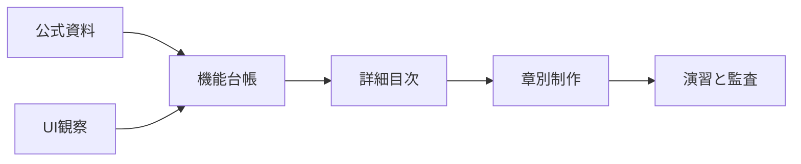

# GitHub完全習得プロジェクト

調査基準日: **2026-10-26**。復元・再確認日: **2026-11-14**。

GitHub.comの日本語教材を制作するための調査・設計基盤です。12部50章の本文は未執筆です。

- [詳細目次](../plans/detailed-toc.md)
- [全体制作計画](../plans/master-plan.md)
- [章別制作順序](../plans/chapter-production-plan.md)
- [機能台帳](../research/feature-inventory.md)
- [公式出典](../research/source-catalog.md)
- [Docs分類](../research/docs-taxonomy.md)
- [UI Map](../research/ui-map.md)
- [未確認事項](../research/research-gaps.md)
- [監査](../audits/audit-report.md)

本文確認、UI実機確認、実践検証を別に管理しています。確認できない仕様は未検証として記録します。

[GitHubリポジトリ](https://github.com/mizu20040814/github-mastery)
